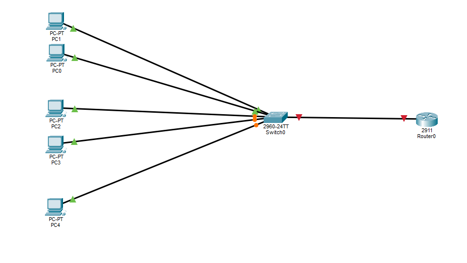
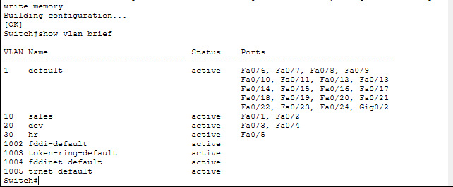
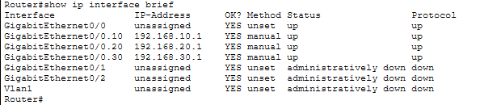
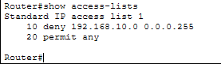
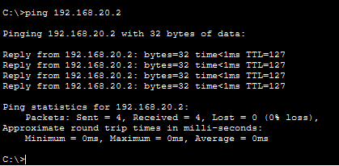
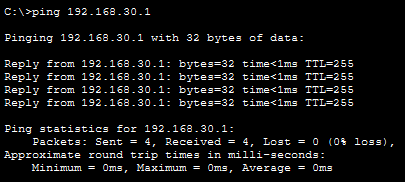
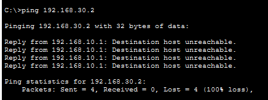

# Inter-VLAN Routing with Router-on-a-Stick and ACL in Cisco Packet Tracer

A small office network lab built in Cisco Packet Tracer. It splits one switch into three VLANs (Sales, Dev, HR), routes traffic between them with a single router, and uses a standard ACL to block Sales traffic from reaching HR.

## Table of Contents

- Overview
- Topology
- Devices
- Cabling
- VLAN Plan
- IP Addressing
- Switch Configuration
- Router Configuration
- ACL Configuration
- Testing
- Key Takeaways

## Overview

This lab covers three core networking skills:

- Segmenting a network with VLANs on a Cisco 2960 switch
- Routing between VLANs with router-on-a-stick (sub-interfaces with 802.1Q encapsulation) on a Cisco 2911 router
- Restricting traffic between departments with a standard access control list

## Topology



## Devices

| Quantity | Device | Model |
|----------|--------|-------|
| 1 | Router | Cisco 2911 |
| 1 | Switch | Cisco 2960 |
| 5 | PCs | 2 Sales, 2 Dev, 1 HR |

## Cabling

All cables are copper straight-through.

| From | To |
|------|----|
| sales1 | Switch Fa0/1 |
| sales2 | Switch Fa0/2 |
| dev1 | Switch Fa0/3 |
| dev2 | Switch Fa0/4 |
| hr | Switch Fa0/5 |
| Switch G0/1 | Router G0/0 |

## VLAN Plan

| VLAN ID | Name | Switch Ports | Subnet |
|---------|------|--------------|--------|
| 10 | sales | Fa0/1 - Fa0/2 | 192.168.10.0/24 |
| 20 | dev | Fa0/3 - Fa0/4 | 192.168.20.0/24 |
| 30 | hr | Fa0/5 | 192.168.30.0/24 |

## IP Addressing

| Device | IP Address | Subnet Mask | Default Gateway |
|--------|------------|-------------|-----------------|
| sales1 | 192.168.10.2 | 255.255.255.0 | 192.168.10.1 |
| sales2 | 192.168.10.3 | 255.255.255.0 | 192.168.10.1 |
| dev1 | 192.168.20.2 | 255.255.255.0 | 192.168.20.1 |
| dev2 | 192.168.20.3 | 255.255.255.0 | 192.168.20.1 |
| hr | 192.168.30.10 | 255.255.255.0 | 192.168.30.1 |

Router sub-interface addresses:

| Sub-interface | VLAN | IP Address |
|---------------|------|------------|
| G0/0.10 | 10 | 192.168.10.1 |
| G0/0.20 | 20 | 192.168.20.1 |
| G0/0.30 | 30 | 192.168.30.1 |

## Switch Configuration

Create the VLANs, assign the access ports, and set the uplink to the router as a trunk.

```
enable
configure terminal

vlan 10
name sales
exit

vlan 20
name dev
exit

vlan 30
name hr
exit

interface range fastEthernet 0/1 - 2
switchport mode access
switchport access vlan 10
exit

interface range fastEthernet 0/3 - 4
switchport mode access
switchport access vlan 20
exit

interface fastEthernet 0/5
switchport mode access
switchport access vlan 30
exit

interface gigabitEthernet 0/1
switchport mode trunk
exit
```

Screenshot of the VLAN table:



## Router Configuration

Enable the physical interface and create one sub-interface per VLAN. Each sub-interface acts as the default gateway for its VLAN.

```
enable
configure terminal

interface gigabitEthernet 0/0
no shutdown

interface gigabitEthernet 0/0.10
encapsulation dot1Q 10
ip address 192.168.10.1 255.255.255.0

interface gigabitEthernet 0/0.20
encapsulation dot1Q 20
ip address 192.168.20.1 255.255.255.0

interface gigabitEthernet 0/0.30
encapsulation dot1Q 30
ip address 192.168.30.1 255.255.255.0
exit
```

Screenshot of the router interfaces:



## ACL Configuration

A standard ACL blocks the Sales subnet from reaching the HR subnet. It sits on the HR sub-interface in the outbound direction. All other traffic stays permitted.

```
configure terminal
access-list 1 deny 192.168.10.0 0.0.0.255
access-list 1 permit any

interface gigabitEthernet 0/0.30
ip access-group 1 out
exit
```

Screenshot of the ACL:



## Testing

Expected results for each test:

| Test | Source | Destination | Expected Result |
|------|--------|-------------|-----------------|
| Same VLAN | sales1 | sales2 | Success |
| Same VLAN | dev1 | dev2 | Success |
| Inter-VLAN | sales1 | dev1 | Success |
| Inter-VLAN | dev1 | hr | Success |
| Blocked by ACL | sales1 | hr | Fails |
| Blocked by ACL | sales2 | hr | Fails |

Test screenshots:







Note: The ACL filters traffic leaving the router toward HR. A ping from HR to a Sales PC also fails, because the reply from Sales gets blocked on its way back to HR.

## Key Takeaways

- One trunk link carries all VLAN traffic between the switch and the router.
- Each router sub-interface needs its own 802.1Q tag and IP address.
- A standard ACL filters by source address only, so place it close to the destination.
- Test same-VLAN, inter-VLAN, and blocked paths to confirm the design works.

## Tools

- Cisco Packet Tracer

## Author

Khalid Ebne Walid Sameer
